I'm an MSc Computer Engineering student focused on **robotics, control and automation**.
I like building things that sit between software and the physical world: simulators, embedded firmware, data-driven models and on-device AI.

[LinkedIn](https://www.linkedin.com/in/alex-martinelli-28a003251) · [Email](mailto:martinelli.alex.2701@gmail.com)

## Featured

### [Chevin](https://github.com/alex-martinelli/chevin-showcase)

Android app that finds blurry and duplicate photos with on-device AI: quality filters, a NIMA aesthetic model, a taste model trained on the phone and duplicate grouping. I built the whole AI pipeline. In closed testing on Google Play.

`Kotlin` `TensorFlow Lite` `OpenCV` `ML Kit`

## Projects

**Robotics and control**

- [**multi-agent-cps-simulator**](https://github.com/alex-martinelli/multi-agent-cps-simulator): decentralized formation control of heterogeneous nonlinear mobile robots, using feedback linearization and pinning control. `MATLAB` `Simulink`

**Embedded**

- [**esp32-smart-mirror**](https://github.com/alex-martinelli/esp32-smart-mirror): proximity-activated photo frame with an ultrasonic sensor, a TFT display, images from SD card and a temperature and humidity readout. `C++` `ESP32`

**Machine learning**

- [**biometric-emotion-cnn**](https://github.com/alex-martinelli/biometric-emotion-cnn): CNN that predicts emotions from ECG and electrodermal signals, comparing early and late sensor fusion, with SHAP analysis. `Python` `PyTorch`

**Software engineering**

- [**rust-fleet-tracker**](https://github.com/alex-martinelli/rust-fleet-tracker): asynchronous fleet tracking system with a concurrent server and an interactive map client. `Rust` `Tokio`
- [**java-tour-manager**](https://github.com/alex-martinelli/java-tour-manager): guided-tour reservation system built with MVC, Strategy and State patterns, JSON persistence and JUnit 5 tests. `Java`

## Toolbox

**Languages:** C · C++ · Rust · ARM and MIPS assembly · Java · Kotlin · Python · SQL · MATLAB/Simulink · Haskell · Scheme · Prolog · Bash

**Areas:** control theory · multi-agent systems · deep learning · computer vision · on-device ML (TensorFlow Lite) · embedded systems (ESP32) · concurrent programming
